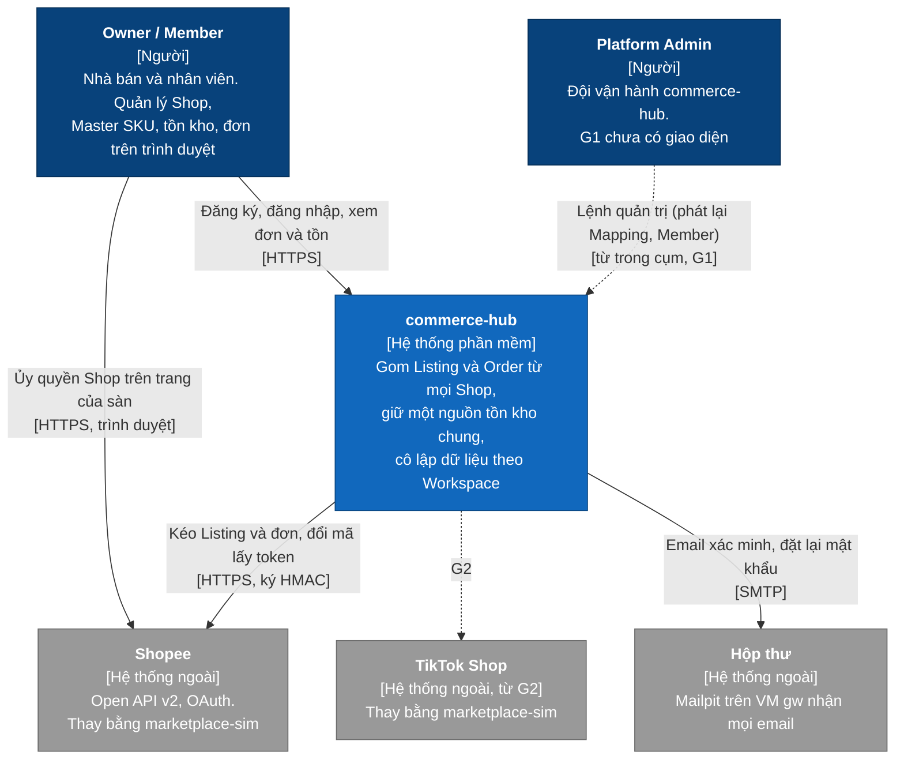

# 3. Bối cảnh và phạm vi

## 3.1 Bối cảnh nghiệp vụ (C4 Context)

| Đối tác | Trao đổi gì ở G1 | Ghi chú |
|---|---|---|
| Owner / Member | Đăng ký, xác minh email, đăng nhập (F1.1a–b); tạo, chuyển Workspace (F1.1c); kết nối Shop (F2.1a); Master SKU, ghép Listing, khai báo tồn (F3, F4.1b); xem đơn (F5.1a) | G1 chỉ có Owner qua giao diện. Member với Role khác tạo bằng fixture của test; lời mời ở G2 (ticket [05](../.scratch/architecture-g0-g1/issues/05-identity-model.md#answer)) |
| Platform Admin | Phát lại Mapping của một Workspace (catalog), phát lại Member (workspace) | G1 chỉ khai báo realm role `platform-admin` và client `admin-web`, chưa dựng ứng dụng admin. Đọc dữ liệu chéo Workspace (PA-*) nằm ngoài đích của map |
| Shopee (giả lập) | OAuth (SIM-04), làm mới token (SIM-05), ký request (SIM-06), kéo Listing (`get_item_list`, `get_model_list`), kéo đơn (SIM-08) | Sàn là nguồn sự thật của Listing và đơn. Webhook (SIM-14) và đẩy tồn (SIM-10..12) từ G2 |
| TikTok Shop (giả lập) | Chưa có | G2 thêm dialect trong cùng pod `marketplace-sim` |
| Hộp thư | Keycloak gửi email xác minh và đặt lại mật khẩu tới Mailpit chạy trên VM `gw`, ngoài cụm | Hàng đợi email có retry (C3) sang G2 cùng `notification` |

Ngoài phạm vi G1: hãng vận chuyển (carrier-sim, G4), webhook từ sàn (G2), người mua ảo và bộ sinh đơn (SIM-18, G2). Ở G1 đơn được tạo và chuyển trạng thái bằng admin API của simulator.

## 3.2 Bối cảnh kỹ thuật

Mọi người dùng vào lab qua Tailscale ([homelab](../../platform/docs/homelab-hyperv.md)). Domain của lab là `lab.internal`: dnsmasq trên VM `gw` trả wildcard `*.lab.internal` về IP `10.20.0.200` của Gateway `edge` (Envoy Gateway), nơi kết thúc TLS bằng chứng chỉ wildcard của CA nội bộ ([ADR-0013](../adr/0013-gateway-api-envoy-gateway-shared-edge.md), [ADR-0014](../adr/0014-lab-pki-and-dns.md)). Từ ngoài cụm chỉ tới được các hostname sau ([ADR-0011](../adr/0011-nextjs-bff-with-server-side-session.md), ticket [12](../.scratch/architecture-g0-g1/issues/12-shopee-sim.md#answer), ticket [16](../.scratch/architecture-g0-g1/issues/16-cluster-entry.md#answer)).

| Kênh | Từ → tới | Giao thức, định dạng |
|---|---|---|
| `app.lab.internal` | Trình duyệt → `edge` → `seller-web` | HTTPS. Trang Next.js và `/api/*` cùng origin. Cookie `__Host-session` (`HttpOnly; Secure; SameSite=Lax`) |
| `auth.lab.internal` | Trình duyệt → `edge` → Keycloak | HTTPS, `edge` re-encrypt tới Keycloak. OIDC: đăng nhập, đăng ký (`prompt=create`), link xác minh email, đặt lại mật khẩu. Chỉ mở `/realms/commerce-hub`, `/resources/`, `/.well-known/` ([keycloak.md](../standards/keycloak.md)) |
| `shopee-sim.lab.internal` | Trình duyệt → `marketplace-sim` (trang ủy quyền); `channel-connector` → `marketplace-sim` (API), cả hai qua `edge` | HTTPS. Shopee Open API v2 dưới `/api/v2/...`, ký HMAC kèm `timestamp`, lệch quá 5 phút thì bị từ chối (SIM-06). Connector dùng hostname này làm base URL vì Shopee phục vụ trang ủy quyền cùng host với API |
| Callback OAuth | Trang ủy quyền của sàn → `app.lab.internal` → gateway → `channel-connector` | HTTPS. Workspace lấy từ `state` và phiên |
| SMTP | Keycloak → Mailpit trên `gw` | SMTP `10.20.0.5:1025`, không qua `edge`. UI và API của Mailpit ở `http://10.20.0.5:8025` cho Mac và runner CI |

UI vận hành cũng đi qua `edge` vì SSO bằng Keycloak cần redirect URI ổn định: `argocd.lab.internal` (Argo CD), `grafana.lab.internal` (Grafana, xem Tempo, Loki, Prometheus qua Explore), `kc-admin.lab.internal` (Keycloak Admin Console). Prometheus, Alertmanager và admin API của `marketplace-sim` không mở ra ngoài, chỉ dùng `kubectl port-forward`.

Từ G2 thêm `tiktok-sim.lab.internal` (cùng `HTTPRoute` và Service của `marketplace-sim`) và `webhooks.lab.internal` cho `webhook-ingress` (tên chốt ở spec G2).

Hạ tầng phát triển và vận hành (không thuộc runtime của sản phẩm): GitHub (code, Actions, Packages), registry image trên `gw` (`10.20.0.5:5000`), RustFS trên `gw` (backup PostgreSQL), MacBook dev chạy `platform/compose` ([mục 8.12](08-crosscutting-concepts.md#812-vòng-phát-triển-và-test)).
