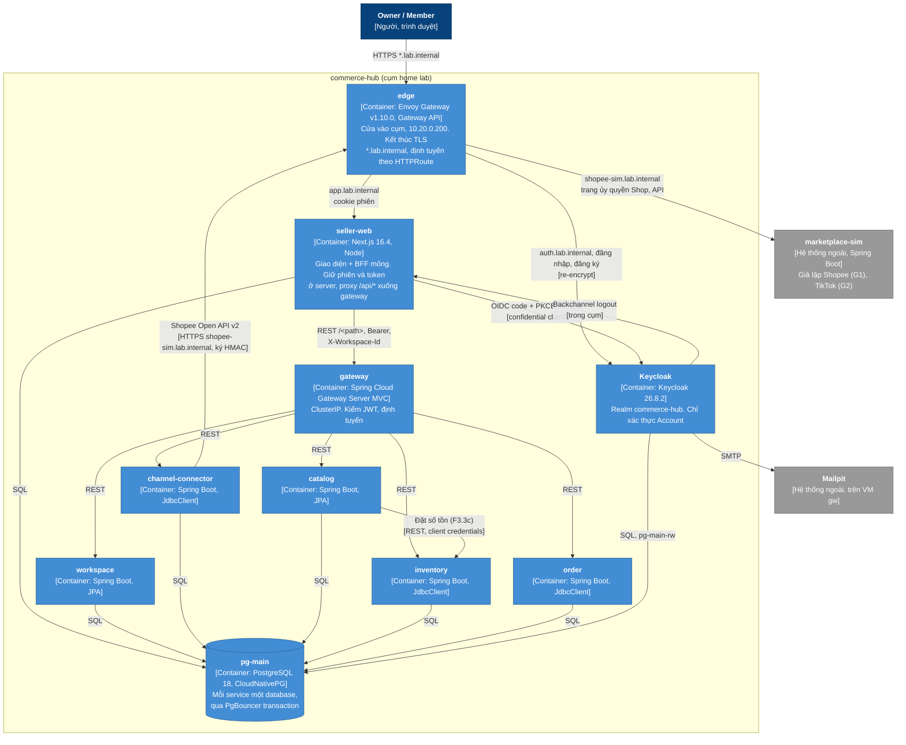
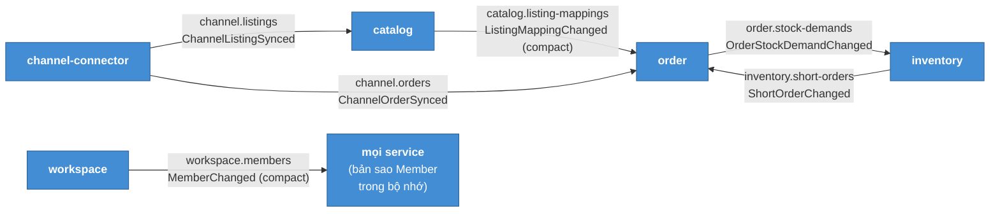
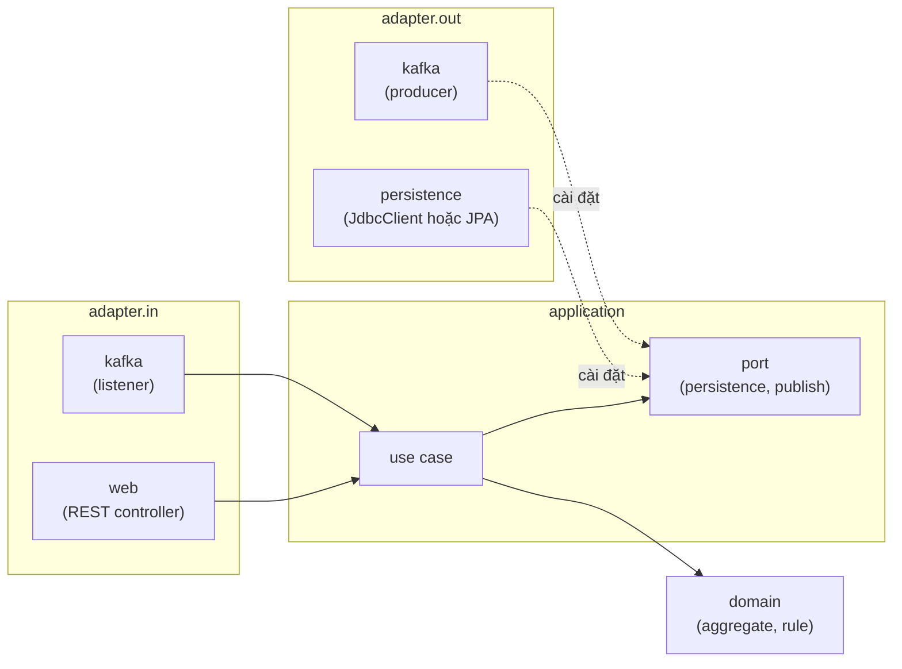

# 5. Building block

## 5.1 Mức 1: các container của G1 (C4 Container)

Sơ đồ chia thành hai góc nhìn để đọc được: đường request đồng bộ (5.1.1) và luồng event (5.1.2). Bảng 5.1.3 liệt kê mọi quan hệ.

### 5.1.1 Đường request đồng bộ

`edge` là Gateway (Gateway API, Envoy) ở cửa vào cụm, khác container `gateway` (Spring Cloud Gateway) đứng sau `seller-web`. Request của người dùng đi trình duyệt → `edge` → `seller-web` → `gateway` → service ([ADR-0013](../adr/0013-gateway-api-envoy-gateway-shared-edge.md)). Pod gọi `*.lab.internal` (như `channel-connector` gọi simulator) cũng đi qua `edge`.

### 5.1.2 Luồng event qua Kafka

Mỗi mũi tên là một topic, mang đúng một loại record. Mọi service cũng đọc `workspace.members` vào bộ nhớ; để sơ đồ gọn, chỉ vẽ một mũi tên cho cả nhóm.

Kafka chạy bằng Strimzi (3 broker KRaft, RF 3, `min.insync.replicas` 2), schema Avro đăng ký ở Apicurio Registry. Chi tiết topic ở [mục 8.5](08-crosscutting-concepts.md#85-event-và-kafka).

### 5.1.3 Trách nhiệm từng container

| Container | Công nghệ | Trách nhiệm ở G1 | Dữ liệu sở hữu (database riêng trên `pg-main`) | Phát | Nhận |
|---|---|---|---|---|---|
| `edge` | Envoy Gateway v1.10.0, Gateway API v1.6.1 | Cửa vào cụm: kết thúc TLS bằng chứng chỉ wildcard `*.lab.internal`, redirect HTTP sang HTTPS, định tuyến theo `HTTPRoute` của từng app, re-encrypt tới Keycloak. App `platform` sở hữu | — | — | — |
| `seller-web` | Next.js 16.4, `openid-client` 6, TanStack Query, driver `pg` | Giao diện tiếng Việt. BFF mỏng: phiên, refresh, CSRF, proxy 1:1 `/api/*`. Không gom dữ liệu, không logic nghiệp vụ. Trình duyệt tự gom dữ liệu của hai service | `seller_web`: bảng phiên, token mã hóa AES-GCM. Không có `workspace_id` (phiên thuộc Account) | — | — |
| `gateway` | Spring Cloud Gateway Server MVC (train 2025.1.x), virtual thread | Kiểm JWT (mọi route), định tuyến theo tiền tố tài nguyên `/v1/...` tới service. Chỉ nhận traffic từ `seller-web`. Không CORS, không kiểm Member, không rate limit ở G1. Timeout chung, không retry ([ticket 18](../.scratch/architecture-g0-g1/issues/18-gateway-g1.md#answer)) | — | — | — |
| `workspace` | Spring Boot 4.1, JPA | Account (tạo JIT ở `GET /me`), Workspace, Member, Role, Scope (F1.1a–c, F1.2a–b). Cổng `email_verified` khi tạo Workspace. Lệnh phát lại Member | Account (bảng toàn cục, không RLS), Workspace, Member | `workspace.members` | — |
| `channel-connector` | Spring Boot 4.1, `JdbcClient` | Kết nối Shop qua OAuth (F2.1a), lưu token, kéo Listing và đơn ban đầu (F2.4a), poll đơn (F5.2b), chuẩn hóa sang canonical (F5.2c). Tính UUIDv5. Ánh xạ trạng thái sàn | Shop, `shop_authorization` (token mã hóa Tink, N11, [ADR-0016](../adr/0016-marketplace-token-encryption-with-tink.md)), `sync_cursor` (hàng đợi việc và checkpoint theo Shop × `ORDER`/`LISTING`/`TOKEN`, [ADR-0015](../adr/0015-marketplace-sync-as-postgres-work-queue.md)) | `channel.orders`, `channel.listings` | — |
| `catalog` | Spring Boot 4.1, JPA (upsert có version guard bằng native query) | Master SKU (F3.1a), Listing (F3.2a), ghép tự động và thủ công (F3.3a–b), job tạo Master SKU hàng loạt (F3.3c). Lệnh phát lại Mapping | Master SKU, Listing, Mapping, job F3.3c | `catalog.listing-mappings` | `channel.listings` |
| `inventory` | Spring Boot 4.1, `JdbcClient` | StockItem, Available (F4.1a), "Đặt số tồn" và "Điều chỉnh" (F4.1b), giữ và nhả tồn (F4.2a–b), sổ cái (F4.3a), Short order (BR-19), Warehouse mặc định (BR-17), job bất biến BR-29, metric Oversell | `stock_item`, `reservation`, `ledger_entry`, `order_inventory_state` | `inventory.short-orders` | `order.stock-demands` |
| `order` | Spring Boot 4.1, `JdbcClient` | Order canonical và trạng thái chuẩn hóa, danh sách đơn gộp (F5.1a), che thông tin người nhận theo Role (N11). Gắn Master SKU vào dòng đơn từ bản sao Mapping (BR-16). Quyết định trạng thái nào giữ tồn (BR-18) | Order, OrderLine, bản sao Mapping (một dòng mỗi Listing), bản sao Short order | `order.stock-demands` | `channel.orders`, `catalog.listing-mappings`, `inventory.short-orders` |
| Keycloak | Keycloak 26.8.2 | Realm `commerce-hub`: mật khẩu, xác minh email, phiên, khóa đăng nhập (BR-02), Terms and Conditions. Client `seller-web` (confidential), client service account | Database riêng, nối thẳng `pg-main-rw` (không qua PgBouncer) | — | — |
| `pg-main` | CloudNativePG 1.30.1, PostgreSQL 18; Pooler PgBouncer `transaction` | Database cho mọi service, Keycloak, `seller_web` và `marketplace_sim`. 1 instance ở lab. Backup Barman Cloud lên RustFS, `archive_timeout` 1 phút (N10) | — | — | — |
| Kafka, Apicurio | Strimzi 1.3.1, Kafka 4.3.2; Apicurio Registry 3.3 | Backbone event, Schema Registry | — | — | — |

Mọi service ở bảng trên (trừ `seller-web` và `gateway`) đọc `workspace.members` bằng phần code `workspace-access` (nằm trong service; chép hay tách thư viện quyết ở G1, [ADR-0018](../adr/0018-self-contained-services-no-shared-library-yet.md)). Phần này tự gán mọi partition, không dùng consumer group, đọc lại từ đầu khi khởi động. Pod chỉ ready khi đã đọc tới end offset ([ADR-0008](../adr/0008-keycloak-authn-only-members-replicated-via-kafka.md)).

Chưa có ở G1: `webhook-ingress`, `notification` (G2), `fulfillment` (G4), `reporting` (G6), Redis (G3).

### 5.1.4 Simulator

`marketplace-sim` không thuộc sản phẩm, nhưng được build và deploy như một service (chart `app`, Argo CD, namespace `simulators`). Một repo, một pod phục vụ cả hai sàn. Module `sim-core` giữ trạng thái, vòng đời token, nút chỉnh AS-xx, admin API và bộ đếm. Mỗi sàn một module dialect (`dialect-shopee` ở G1, `dialect-tiktok` ở G2) giữ HTTP, chữ ký, mã lỗi và máy trạng thái đơn. Request chia cho dialect theo đường dẫn. Admin API chạy trên port riêng, có OpenAPI trong `contracts`. Dữ liệu lưu ở database `marketplace_sim` trên `pg-main`, không bật RLS. Chi tiết ở ticket [12](../.scratch/architecture-g0-g1/issues/12-shopee-sim.md#answer).

### 5.1.5 Thành phần nền tảng trong cụm

Không vẽ trong sơ đồ vì mọi container đều dùng:

- **Argo CD** 3.6.1: đồng bộ cụm từ repo `gitops`, app-of-apps cộng `ApplicationSet` cho service.
- **Sealed Secrets**: secret nằm trong `gitops` ở dạng đã mã hóa.
- **cert-manager**: cần cho plugin Barman Cloud và cấp chứng chỉ wildcard `*.lab.internal` của `edge` từ `ClusterIssuer lab-ca` (intermediate của CA nội bộ, [ADR-0014](../adr/0014-lab-pki-and-dns.md)).
- **trust-manager** v0.26.0: sinh trust bundle (root CA của lab cộng CA công khai) để chart `app` mount cho JVM và Node ([mục 8.15](08-crosscutting-concepts.md#813-cửa-vào-cụm-pki-và-trust)).
- **LGTM**: OTel Collector (DaemonSet), Prometheus, Alertmanager, Loki (monolithic), Tempo, Grafana.
- **Envoy Gateway** v1.10.0 (CRD Gateway API v1.6.1): controller của Gateway `edge` (pod Envoy vẽ ở 5.1.1). App `platform` sở hữu CRD, `GatewayClass envoy`, `EnvoyProxy`, Gateway `edge` và route của Keycloak, Argo CD, Grafana; chart `app` chỉ sinh `HTTPRoute` ([ADR-0013](../adr/0013-gateway-api-envoy-gateway-shared-edge.md)).

Cỡ của từng thành phần ở ticket [04](../.scratch/architecture-g0-g1/issues/04-resource-budget.md#answer).

## 5.2 Mức 2: bên trong một service

Mọi service Spring Boot, kể cả `marketplace-sim`, dùng chung một layout hexagonal trong một module Gradle (ticket [11](../.scratch/architecture-g0-g1/issues/11-service-template.md#answer)). Package gốc là `io.github.<user>.commercehub.<service>`.

- Quy ước phụ thuộc (không có test tự động, [ADR-0018](../adr/0018-self-contained-services-no-shared-library-yet.md)): `domain` không import Spring hay adapter; `application` không import adapter. Service JPA được dùng `jakarta.persistence.*` trong `domain`.
- Chưa có thư viện dùng chung ([ADR-0018](../adr/0018-self-contained-services-no-shared-library-yet.md)). Phần lặp lại giữa các service nằm trong từng service, chép từ template `hello` khi tạo service. Bảng dưới là các nhóm code từng dự kiến đặt trong `libs/service-kit`; giữ làm danh sách ứng viên khi G1 xét lại việc tách thư viện:

| Nhóm (từng là module) | Chứa |
|---|---|
| `workspace-access` | `ScopedValue` giữ Workspace, filter HTTP dựng `MemberContext`, interceptor consumer Kafka, bản sao Member, hook RLS; `test-fixtures` gồm test catalog RLS và test hành vi qua PgBouncer |
| `ids` | UUIDv7 |
| `events` | Port publish (bản G1 `AFTER_COMMIT`), cấu hình producer, error handler retry rồi DLT |
| `web` | Problem Details, cursor, `Idempotency-Key`, `ETag`/`If-Match` |
| `test-support` | ~~Luật ArchUnit~~, cấu hình Testcontainers |
| ~~`gradle-plugin`~~ | ~~Convention plugin `commercehub.spring-service`~~. Bỏ: mỗi service tự khai build theo mặc định Initializr ([spring-service.md](../standards/spring-service.md)) |

Không vào thư viện: logic nghiệp vụ, bảng quyền F1.2a của từng service, code sinh từ Avro/OpenAPI, UUIDv5 tất định (thuộc `contracts`), version guard, business metric.

### `channel-connector`: anti-corruption layer

Bên trong `channel-connector`, `adapter.out` có một port cho mỗi việc gọi sàn và một adapter theo từng sàn (Shopee ở G1, TikTok ở G2). Token, `shop_cipher`, `partner_id`, chữ ký, payload gốc, cấu trúc `item_id`/`model_id`, bảng ánh xạ trạng thái (SRS 4.1) và cách gộp dòng gốc chỉ tồn tại ở đây. Ra khỏi connector chỉ còn model canonical ([mục 8.6](08-crosscutting-concepts.md#86-canonical-model-id-tiền-và-thời-gian)).

### `seller-web`

Không theo layout hexagonal (Node). Route: `/auth/login`, `/auth/callback`, `/auth/logout`, `/auth/session`, `/auth/backchannel-logout`, proxy `/api/[...path]`. `proxy.ts` chỉ chuyển hướng trang khi chưa có phiên. Trang dưới `/w/{workspaceId}/…`. Migration SQL nằm trong repo, chạy bằng image Flyway riêng ([ADR-0011](../adr/0011-nextjs-bff-with-server-side-session.md)).
