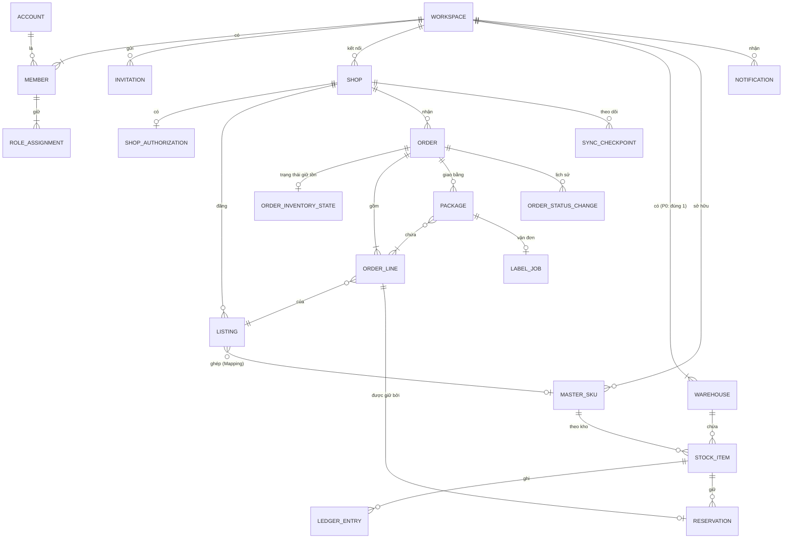

# commerce-hub: Domain model (mức khái niệm)

- Phiên bản: 1.1, ngày 2026-11-13 (1.1: OrderInventoryState và ranh giới nhất quán của inventory, theo [ADR-0007](../adr/0007-stock-balance-plus-ledger-in-one-transaction.md))
- Phạm vi: P0. Tên thực thể theo [GLOSSARY.md](../GLOSSARY.md). Quy tắc theo mã BR trong [SRS](srs.md).

Tài liệu này mô tả **khái niệm và quan hệ**, chưa phải schema. Kiểu dữ liệu, bảng và index được quyết định ở phase thiết kế, trong từng service.

## 1. Sơ đồ quan hệ

## 2. Thực thể theo bounded context

Ranh giới context đi theo [B1](../requirements-and-techniques.md#b1-bounded-context-và-service). Một context chỉ tham chiếu thực thể của context khác bằng ID, không truy cập trực tiếp.

### Identity & Workspace

| Thực thể | Thuộc tính chính | Bất biến |
|---|---|---|
| **Account** | email (đã chuẩn hóa), trạng thái xác minh, thời điểm và phiên bản đồng ý chính sách | Email duy nhất (BR-01) |
| **Workspace** | tên, Owner, trạng thái (`Active`, `Locked`, `Deleted` kèm thời điểm xóa), hạn mức | Có đúng một Owner, không đổi được. Owner tối đa 5 Workspace (BR-03) |
| **Member** | Account, Workspace | Mỗi cặp (Account, Workspace) có tối đa một Member |
| **RoleAssignment** | vai trò, phạm vi (mọi Shop / danh sách Shop; mọi Warehouse / danh sách Warehouse) | Vai trò Owner chỉ gán cho người tạo Workspace |
| **Invitation** | email, vai trò và phạm vi, hạn dùng, trạng thái | Mỗi (Workspace, email) có tối đa một lời mời đang mở |

### Channel (kết nối sàn)

| Thực thể | Thuộc tính chính | Bất biến |
|---|---|---|
| **Shop** | Workspace, sàn, shop_id của sàn, tên, trạng thái (`Active`, `Disconnected`), lý do ngắt, cờ sắp hết hạn | (sàn, shop_id) thuộc tối đa một Workspace chưa bị xóa (BR-08) |
| **ShopAuthorization** | access token, refresh token (đã mã hóa), thời hạn từng loại, hạn ủy quyền | Mỗi Shop có nhiều nhất một lần làm mới đang chạy (BR-10) |
| **SyncCheckpoint** | Shop, loại dữ liệu (đơn, listing), mốc `update_time` cuối | Chỉ tiến lên. Khi đọc thì trừ thêm khoảng chồng lấn |

### Catalog

| Thực thể | Thuộc tính chính | Bất biến |
|---|---|---|
| **MasterSku** | mã SKU, tên, giá vốn, mã vạch, ảnh, trạng thái | Mã duy nhất trong Workspace (BR-13) |
| **Listing** | Shop, mã sản phẩm và biến thể trên sàn, `seller_sku`, tên, giá, trạng thái trên sàn, tồn trên sàn lần cuối, trạng thái đồng bộ | (Shop, mã biến thể trên sàn) là duy nhất |
| **Mapping** | Listing → MasterSku | Một Listing có tối đa một Mapping (BR-15) |

### Inventory

| Thực thể | Thuộc tính chính | Bất biến |
|---|---|---|
| **Warehouse** | Workspace, tên, là kho mặc định | P0: mỗi Workspace có đúng một Warehouse |
| **StockItem** | (MasterSku, Warehouse), On hand, tổng Reservation, đã khai báo tồn hay chưa | Số dư bằng tổng LedgerEntry (BR-29). Available có thể âm |
| **Reservation** | StockItem, dòng đơn, số lượng, trạng thái (`Open`, `Released`, `Consumed`) | Mỗi dòng đơn có tối đa một Reservation `Open` (BR-20). Dòng ghép lại sang SKU khác có thêm một Reservation `Released` cũ |
| **LedgerEntry** | StockItem, thời điểm, thay đổi On hand, thay đổi Reservation, loại lý do, tham chiếu, người thực hiện, khóa idempotency (lệnh REST), có gây Oversell hay không | Chỉ thêm, không sửa hay xóa (BR-28) |
| **OrderInventoryState** | Order, version Order đã áp dụng, cờ Short order | Không áp dụng version Order cũ hơn hoặc bằng giá trị đang lưu (BR-20). inventory là nguồn sự thật của cờ Short order |

Published stock không phải thực thể được lưu trữ: nó được tính từ Available (BR-23). Số đã đẩy và đã được sàn xác nhận được lưu trên Listing.

### Order

| Thực thể | Thuộc tính chính | Bất biến |
|---|---|---|
| **Order** | Shop, mã đơn của sàn, trạng thái chuẩn hóa, trạng thái gốc, `update_time` của sàn, các cờ (Short order, có Unmapped line, có yêu cầu hủy, đang chờ sàn hủy), người nhận (thông tin cá nhân), tổng tiền, tiền tệ, COD hay không | (Shop, mã đơn) là duy nhất (BR-32). Không chấp nhận `update_time` cũ hơn giá trị đang lưu (BR-31) |
| **OrderLine** | Listing, Master SKU (nếu đã ghép), số lượng, số lượng đã hủy, đơn giá | Số lượng đã hủy ≤ số lượng |
| **OrderStatusChange** | trạng thái cũ và mới (gốc và chuẩn hóa), thời điểm, nguồn (webhook, đối soát, kéo bù, thao tác người dùng) | Chỉ thêm |

### Fulfillment

| Thực thể | Thuộc tính chính | Bất biến |
|---|---|---|
| **Package** | Order, các dòng đơn, mã package của sàn, trạng thái trong kho (`Chờ nhặt`, `Đã đóng gói`, `Đã bàn giao`, `Đã hủy`), phương thức giao, mã vận đơn, cờ cần kiểm tra | Mỗi Package được sắp xếp giao tối đa một lần (BR-35) |
| **LabelJob** | Package, bước hiện tại, số lần thử, file đã lưu | Đã có file thì không gọi sàn lại |

### Notification

| Thực thể | Thuộc tính chính | Bất biến |
|---|---|---|
| **Notification** | Workspace, người nhận, loại, nội dung, khóa gộp, đã đọc | Một sự kiện nguồn tạo tối đa một Notification cho mỗi người nhận |

## 3. Ranh giới nhất quán

Mỗi dòng dưới đây là một đơn vị thay đổi nguyên tử, tức một aggregate. Mọi thay đổi vượt qua ranh giới này đều đi qua event và là eventual consistency.

| Aggregate | Gồm | Vì sao gom như vậy |
|---|---|---|
| StockItem | Mọi StockItem mà một Order chạm tới (cùng Reservation, LedgerEntry của chúng) + OrderInventoryState của các Order liên quan | Giữ, nhả, trừ tồn, bút toán và cờ Short order phải cùng thành công (BR-19, BR-28, BR-29). Short order là trạng thái theo Order nên một Order nhiều SKU phải nằm trong một thay đổi. Khóa theo thứ tự cố định: StockItem trước, rồi OrderInventoryState ([ADR-0007](../adr/0007-stock-balance-plus-ledger-in-one-transaction.md)) |
| Order | Order + OrderLine + OrderStatusChange | Trạng thái và số lượng đã hủy thay đổi cùng nhau |
| Package | Package + LabelJob | Vận đơn gắn với đúng một Package |
| Shop | Shop + ShopAuthorization + SyncCheckpoint | Trạng thái kết nối và token phải nhất quán |
| Listing | Listing + Mapping | Ghép là thuộc tính của Listing |

Hệ quả: ghép Listing (Catalog) dẫn tới giữ tồn bù (Inventory) và gỡ cờ Unmapped line (Order). Ba việc này **không** cùng một transaction mà nối với nhau bằng event (F3.3b).
